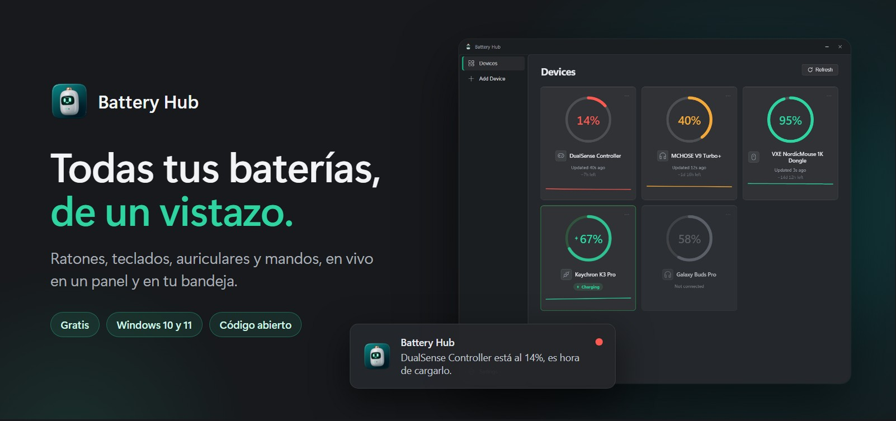

<div align="center">



<p>
  <a href="README.md"></a>
  <a href="README.es.md"></a>
  <a href="README.zh.md"></a>
  <a href="README.he.md"></a>
  <a href="README.pt.md"></a>
  <a href="README.ru.md"></a>
</p>

<p>
  <a href="https://github.com/battery-hub/battery-hub/releases/latest"></a>
  <a href="https://buymeacoffee.com/batteryhub"></a>
</p>

<p>
  <a href="https://github.com/battery-hub/battery-hub/releases/latest"></a>
  <a href="https://github.com/battery-hub/battery-hub/releases"></a>
  <a href="LICENSE"></a>
  
</p>

</div>

Battery Hub lee el nivel de batería de tus dispositivos inalámbricos directamente desde sus receptores, cables y Bluetooth, los muestra en un panel en vivo y en la bandeja del sistema, y te avisa antes de que alguno se quede sin carga. Es gratuito, de código abierto y funciona por completo en tu PC.

<p align="center">
  <a href="#características">Características</a> •
  <a href="#instalación">Instalación</a> •
  <a href="#primeros-pasos">Primeros pasos</a> •
  <a href="#dispositivos-compatibles">Dispositivos compatibles</a> •
  <a href="#solución-de-problemas">Solución de problemas</a> •
  <a href="#privacidad">Privacidad</a> •
  <a href="#compilar-desde-el-código-fuente">Compilar desde el código fuente</a>
</p>

## Características

- **Todos tus dispositivos en un lugar**: ratones, teclados, auriculares y mandos, cada uno con un anillo de carga por colores.
- **Iconos en la bandeja**: un indicador de batería en vivo para cada dispositivo, junto al reloj.
- **Historial y estimaciones**: gráficos de 24 horas y 7 días, ritmo de descarga, tiempo restante y la última carga.
- **Avisos de batería baja**: una notificación de Windows al nivel que elijas, para todos los dispositivos o para cada uno.
- **Sabe cuándo un dispositivo está apagado**: muestra *En reposo o apagado* en lugar de una lectura antigua.
- **Configuración de dispositivos desconocidos**: un escaneo de 30 segundos encuentra el nivel de batería de los dispositivos que no se reconocen automáticamente.
- **Seis idiomas**: English, Español, 简体中文, עברית, Português y Русский.
- **Hecho para Windows 11**: temas claro y oscuro, un panel en la bandeja, opción para reducir animaciones y actualizaciones automáticas.

## Instalación

**Administrador de paquetes de Windows**

```powershell
winget install DORON177.BatteryHub
```

**Instalador**

Descarga `Battery-Hub-Installer-x.y.z.exe` de la [última versión](https://github.com/battery-hub/battery-hub/releases/latest) y ejecútalo. Battery Hub se instala para el usuario actual y no necesita permisos de administrador.

> [!NOTE]
> El instalador no está firmado digitalmente, así que Windows SmartScreen puede mostrar **"Windows protegió su PC"**. Selecciona **Más información → Ejecutar de todas formas**. Los certificados de firma tienen un coste anual que este proyecto gratuito no puede cubrir.

<details>
<summary><strong>Verificar una descarga</strong></summary>
<br>

Cada versión la compila y publica [GitHub Actions](.github/workflows/release.yml) a partir de un commit etiquetado, sin archivos subidos a mano, y cada una incluye un `SHA256SUMS.txt`. En la carpeta donde descargaste el instalador, ejecuta:

```powershell
Get-FileHash .\Battery-Hub-Installer-*.exe -Algorithm SHA256
```

y compara el hash con el del `SHA256SUMS.txt` de esa versión. También puedes buscar el mismo hash en [VirusTotal](https://www.virustotal.com/gui/home/search) para ver los resultados de análisis de ese archivo exacto.

</details>

## Primeros pasos

### Añadir un dispositivo

Abre **Añadir dispositivo**. Los dispositivos que Battery Hub reconoce aparecen como **Compatible**: solo haz clic en **Añadir**. Para cualquier otro, haz clic en **Configurar**:

1. Inicia el escaneo de 30 segundos.
2. Apaga y enciende el dispositivo mientras se escanea. Muchos dispositivos inalámbricos solo informan de su batería al encenderse.
3. Elige el valor que coincide con tu nivel de batería actual.
4. Si el dispositivo usa otra escala, escribe tu nivel real y Battery Hub lo convertirá a partir de entonces.

### El panel

Cada tarjeta muestra el nivel con un anillo verde, amarillo o rojo, si se está cargando, un gráfico de historial, el tiempo restante y la antigüedad de la lectura. Haz clic en una tarjeta para ver su historial completo. Desde el menú ⋯ puedes cambiar el nombre de un dispositivo, su icono u ocultarlo, y puedes arrastrar las tarjetas para reordenarlas. Los dispositivos ocultos conservan su configuración, dejan de consultarse y se pueden restaurar en cualquier momento.

### Ajustes

Idioma, tema, densidad de las tarjetas, reducir animaciones, nivel de batería baja, iconos de la bandeja, inicio con Windows e intervalo de actualización.

## Dispositivos compatibles

Battery Hub lee directamente cientos de dispositivos de Logitech, Razer, SteelSeries, HyperX, Corsair, ASUS, Sony, MCHOSE, VXE, ATK, VGN, Redragon y muchas otras marcas, además de los mandos de Xbox, PlayStation, Nintendo, 8BitDo y Flydigi y cualquier dispositivo Bluetooth que informe de su batería a Windows. La mayoría de los demás se pueden añadir con **Configurar**.

Consulta la [lista completa de dispositivos](README.md#supported-devices) (en inglés) o la del [sitio web](https://battery-hub.github.io/battery-hub/). Si un dispositivo no funciona bien, [infórmanos](https://github.com/battery-hub/battery-hub/issues/new?template=device-support.yml).

## Solución de problemas

- **Algo no funciona.** Abre **Ajustes → Ayuda** y pulsa **Comprobar**. Revisa tu instalación, tu PC y tus dispositivos, te dice dónde está el problema y puede abrir una solicitud de soporte ya rellenada.
- **Un dispositivo no se reconoce.** Tras dos escaneos sin resultados, o tres lecturas fallidas seguidas, aparece el botón **Enviar informe del dispositivo**. Abre en GitHub una solicitud ya rellenada para que la revises y la envíes.
- **El escaneo no captura nada.** Vuelve a ejecutarlo y apaga y enciende el dispositivo mientras se escanea.
- **"No se puede leer la batería de este dispositivo."** Algunos dispositivos bloquean las consultas de batería en su controlador y no se pueden leer.
- **MCHOSE V9 Turbo+ muestra "needs Python + hid module".** Estos auriculares se leen mediante Python. Instala [Python](https://www.python.org/downloads/) y luego ejecuta `pip install hidapi`.
- **Los registros** se guardan en `%APPDATA%\battery-hub\battery-hub.log`.

## Privacidad

Battery Hub funciona por completo en tu PC y no recopila nada. Solo se conecta a GitHub: para buscar y descargar actualizaciones, y para la comprobación de versión en **Ajustes → Ayuda**. Los informes de dispositivos y las solicitudes de soporte abren en tu navegador un formulario de GitHub ya rellenado, y no se envía nada hasta que tú lo envíes. El historial de batería y los ajustes se quedan en `%APPDATA%\battery-hub`.

## Compilar desde el código fuente

Necesitas [Node.js](https://nodejs.org).

```bash
npm install
npm start          # ejecutar en modo desarrollo
npm test           # ejecutar las pruebas
npm run dist       # compilar el instalador de Windows en dist/
npm run installer  # envolverlo en la ventana del instalador
```

| Ruta | Uso |
| --- | --- |
| `src/main` | Proceso principal de Electron: lectura de dispositivos, bandeja, notificaciones y actualizaciones |
| `src/main/hid/drivers` | Controladores de batería de cada familia de dispositivos; `table.js` reúne los dispositivos de pregunta y respuesta simples |
| `src/renderer` | La interfaz y sus traducciones |
| `scripts` | Herramientas de compilación, iconos y la captura de pantalla (`npx electron scripts/screenshot.js`) |

`node-hid` se ejecuta en un proceso aparte, así que un fallo de un controlador no puede cerrar la aplicación.

## Contribuir

Se agradecen las solicitudes de dispositivos, las traducciones y los pull requests. Consulta [CONTRIBUTING.md](CONTRIBUTING.md) para empezar, [CHANGELOG.md](CHANGELOG.md) para el historial de versiones y [SECURITY.md](SECURITY.md) para informar de un problema de seguridad.

## Agradecimientos

Los protocolos de los dispositivos se basan en el trabajo de estos proyectos de código abierto, y cada controlador cita sus fuentes: [HeadsetControl](https://github.com/Sapd/HeadsetControl), [OpenRazer](https://github.com/openrazer/openrazer), [rivalcfg](https://github.com/flozz/rivalcfg), [openinzone](https://github.com/penguinwokrs/openinzone), [SDL](https://github.com/libsdl-org/SDL), [OpenLinkHub](https://github.com/jurkovic-nikola/OpenLinkHub), [HaloBattery](https://github.com/HeyOkay/HaloBattery), los controladores HID del kernel de Linux.

## Apoya el proyecto

Battery Hub es gratuito y lo seguirá siendo. Si te salvó de quedarte sin ratón en plena partida, puedes [invitarle a un café](https://buymeacoffee.com/batteryhub). Ayuda a mantener el proyecto y a añadir más dispositivos.

## Licencia

[MIT](LICENSE) © 2026 Battery Hub contributors
