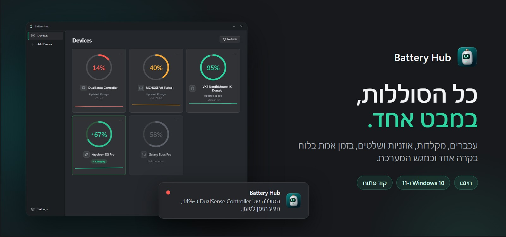

<div align="center">



<p>
  <a href="README.md"></a>
  <a href="README.es.md"></a>
  <a href="README.zh.md"></a>
  <a href="README.he.md"></a>
  <a href="README.pt.md"></a>
  <a href="README.ru.md"></a>
</p>

<p>
  <a href="https://github.com/battery-hub/battery-hub/releases/latest"></a>
  <a href="https://buymeacoffee.com/batteryhub"></a>
</p>

<p>
  <a href="https://github.com/battery-hub/battery-hub/releases/latest"></a>
  <a href="https://github.com/battery-hub/battery-hub/releases"></a>
  <a href="LICENSE"></a>
  
</p>

</div>

<div dir="rtl">

‏Battery Hub קורא את רמת הסוללה של המכשירים האלחוטיים שלכם ישירות מהמקלטים, מהכבלים ומ-Bluetooth, מציג אותם בלוח בקרה חי ובמגש המערכת, ומזהיר אתכם לפני שמשהו נכבה. הוא חינמי, בקוד פתוח ופועל כולו על המחשב שלכם.

<p align="center">
  <a href="#תכונות">תכונות</a> •
  <a href="#התקנה">התקנה</a> •
  <a href="#צעדים-ראשונים">צעדים ראשונים</a> •
  <a href="#מכשירים-נתמכים">מכשירים נתמכים</a> •
  <a href="#פתרון-בעיות">פתרון בעיות</a> •
  <a href="#פרטיות">פרטיות</a> •
  <a href="#בנייה-מקוד-המקור">בנייה מקוד המקור</a>
</p>

## ‏תכונות

- ‏**כל המכשירים במקום אחד**: עכברים, מקלדות, אוזניות ושלטים, לכל אחד טבעת טעינה צבעונית.
- ‏**סמלים במגש המערכת**: מחוון סוללה חי לכל מכשיר, ליד השעון.
- ‏**היסטוריה והערכות**: גרפים של 24 שעות ו-7 ימים, קצב פריקה, זמן שנותר ומתי נטען לאחרונה.
- ‏**התראות על סוללה חלשה**: התראה של Windows ברמה שתבחרו, לכל המכשירים או לכל מכשיר בנפרד.
- ‏**יודע כשמכשיר כבוי**: מציג *במנוחה או כבוי* במקום קריאה ישנה.
- ‏**הגדרה למכשירים לא מוכרים**: סריקה של 30 שניות מוצאת את רמת הסוללה של מכשירים שלא מזוהים אוטומטית.
- ‏**שש שפות**: English, Español, 简体中文, עברית, Português ו-Русский.
- ‏**נבנה עבור Windows 11**: ערכות נושא בהירה וכהה, חלונית במגש, אפשרות להפחתת אנימציות ועדכונים אוטומטיים.

## ‏התקנה

‏**מנהל החבילות של Windows**

```powershell
winget install DORON177.BatteryHub
```

‏**קובץ התקנה**

‏הורידו את `Battery-Hub-Installer-x.y.z.exe` [מהגרסה האחרונה](https://github.com/battery-hub/battery-hub/releases/latest) והפעילו אותו. Battery Hub מותקן עבור המשתמש הנוכחי ולא דורש הרשאות מנהל.

> [!NOTE]
> ‏קובץ ההתקנה לא חתום דיגיטלית, ולכן Windows SmartScreen עשוי להציג **"Windows הגן על המחשב שלך"**. בחרו **מידע נוסף ← הפעל בכל זאת**. אישורי חתימה עולים תשלום שנתי שהפרויקט החינמי הזה לא יכול לממן.

<details>
<summary><strong>אימות ההורדה</strong></summary>
<br>

‏כל גרסה נבנית ומתפרסמת על ידי [GitHub Actions](.github/workflows/release.yml) מתוך commit מתויג, בלי קבצים שהועלו ידנית, וכל אחת כוללת `SHA256SUMS.txt`. בתיקייה שאליה הורדתם את קובץ ההתקנה, הריצו:

```powershell
Get-FileHash .\Battery-Hub-Installer-*.exe -Algorithm SHA256
```

‏והשוו את התוצאה לערך שב-`SHA256SUMS.txt` של אותה גרסה. אפשר גם לחפש את אותו ערך ב-[VirusTotal](https://www.virustotal.com/gui/home/search) כדי לראות תוצאות סריקה של הקובץ הזה בדיוק.

</details>

## ‏צעדים ראשונים

### ‏הוספת מכשיר

‏פתחו את **הוספת מכשיר**. מכשירים ש-Battery Hub מזהה מסומנים **נתמך**: פשוט לחצו **הוספה**. לכל מכשיר אחר, לחצו **הגדרה**:

1. ‏התחילו את הסריקה של 30 שניות.
2. ‏כבו והדליקו את המכשיר בזמן הסריקה. מכשירים אלחוטיים רבים מדווחים על הסוללה רק כשהם נדלקים.
3. ‏בחרו את הערך שמתאים לרמת הסוללה הנוכחית.
4. ‏אם המכשיר משתמש בסולם אחר, הזינו את הרמה האמיתית ו-Battery Hub ימיר אותה מעכשיו והלאה.

### ‏לוח הבקרה

‏כל כרטיס מציג את הרמה עם טבעת ירוקה, צהובה או אדומה, אם המכשיר בטעינה, גרף היסטוריה, הזמן שנותר ומתי נקרא לאחרונה. לחצו על כרטיס כדי לראות את ההיסטוריה המלאה. מתפריט ⋯ אפשר לשנות שם של מכשיר, להחליף את הסמל שלו או להסתיר אותו, ואפשר לגרור כרטיסים כדי לשנות את הסדר. מכשירים מוסתרים שומרים על ההגדרה שלהם, לא נקראים יותר ואפשר להחזיר אותם בכל עת.

### ‏הגדרות

‏שפה, ערכת נושא, צפיפות כרטיסים, הפחתת אנימציות, רמת סוללה חלשה, סמלים במגש, הפעלה עם Windows ותדירות רענון.

## ‏מכשירים נתמכים

‏Battery Hub קורא ישירות מאות מכשירים של Logitech, Razer, SteelSeries, HyperX, Corsair, ASUS, Sony, MCHOSE, VXE, ATK, VGN, Redragon ומותגים רבים נוספים, וגם שלטים של Xbox, PlayStation, Nintendo, 8BitDo ו-Flydigi, וכל מכשיר Bluetooth שמדווח על הסוללה שלו ל-Windows. את רוב המכשירים האחרים אפשר להוסיף עם **הגדרה**.

‏ראו את [רשימת המכשירים המלאה](README.md#supported-devices) (באנגלית) או את הרשימה [באתר](https://battery-hub.github.io/battery-hub/). אם מכשיר לא עובד כמו שצריך, [ספרו לנו](https://github.com/battery-hub/battery-hub/issues/new?template=device-support.yml).

## ‏פתרון בעיות

- ‏**משהו לא עובד.** פתחו **הגדרות ← עזרה** ולחצו **הפעלת בדיקה**. הבדיקה בודקת את ההתקנה, את המחשב ואת המכשירים, אומרת איפה הבעיה ויכולה לפתוח בקשת תמיכה ממולאת.
- ‏**מכשיר לא מזוהה.** אחרי שתי סריקות בלי תוצאה, או שלוש קריאות שנכשלו ברצף, מופיע הכפתור **שליחת דוח מכשיר**. הוא פותח ב-GitHub בקשה ממולאת לבדיקה ולשליחה שלכם.
- ‏**הסריקה לא קלטה כלום.** הריצו אותה שוב, וכבו והדליקו את המכשיר בזמן הסריקה.
- ‏**"לא ניתן לקרוא את הסוללה של המכשיר הזה."** חלק מהמכשירים חוסמים בקשות סוללה בדרייבר שלהם ואי אפשר לקרוא אותם.
- ‏**MCHOSE V9 Turbo+ מציג "needs Python + hid module".** האוזניות האלה נקראות דרך Python. התקינו [Python](https://www.python.org/downloads/) והריצו `pip install hidapi`.
- ‏**יומנים** נשמרים ב-`%APPDATA%\battery-hub\battery-hub.log`.

## ‏פרטיות

‏Battery Hub פועל כולו על המחשב שלכם ולא אוסף שום מידע. הוא מתחבר לאינטרנט רק אל GitHub: כדי לבדוק ולהוריד עדכונים, ולבדיקת הגרסה ב**הגדרות ← עזרה**. דוחות מכשיר ובקשות תמיכה פותחים בדפדפן טופס GitHub ממולא, ושום דבר לא נשלח עד שתשלחו אותו בעצמכם. היסטוריית הסוללה וההגדרות נשמרות ב-`%APPDATA%\battery-hub`.

## ‏בנייה מקוד המקור

‏נדרש [Node.js](https://nodejs.org).

```bash
npm install
npm start          # run in development
npm test           # run the tests
npm run dist       # build the Windows installer into dist/
npm run installer  # wrap it in the branded installer window
```

| נתיב | תפקיד |
| --- | --- |
| `src/main` | התהליך הראשי של Electron: קריאת מכשירים, מגש, התראות ועדכונים |
| `src/main/hid/drivers` | דרייברי סוללה לכל משפחת מכשירים; `table.js` מרכז את המכשירים עם בקשה ותשובה פשוטות |
| `src/renderer` | הממשק והתרגומים שלו |
| `scripts` | כלי בנייה, סמלים וצילום המסך (`npx electron scripts/screenshot.js`) |

‏`node-hid` רץ בתהליך נפרד, כך שתקלה בדרייבר לא יכולה להפיל את האפליקציה.

## ‏תרומה לפרויקט

‏בקשות למכשירים, תרגומים ו-pull requests יתקבלו בברכה. ראו [CONTRIBUTING.md](CONTRIBUTING.md) כדי להתחיל, [CHANGELOG.md](CHANGELOG.md) להיסטוריית הגרסאות ו-[SECURITY.md](SECURITY.md) לדיווח על בעיית אבטחה.

## ‏תודות

‏פרוטוקולי המכשירים מבוססים על העבודה של פרויקטי הקוד הפתוח האלה, וכל דרייבר מציין את המקורות שלו: [HeadsetControl](https://github.com/Sapd/HeadsetControl), [OpenRazer](https://github.com/openrazer/openrazer), [rivalcfg](https://github.com/flozz/rivalcfg), [openinzone](https://github.com/penguinwokrs/openinzone), [SDL](https://github.com/libsdl-org/SDL), [OpenLinkHub](https://github.com/jurkovic-nikola/OpenLinkHub), [HaloBattery](https://github.com/HeyOkay/HaloBattery), דרייברי ה-HID של ליבת Linux.

## ‏תמיכה בפרויקט

‏Battery Hub חינמי ויישאר חינמי. אם הוא הציל אתכם מעכבר שנכבה באמצע משחק, אפשר [לקנות לו קפה](https://buymeacoffee.com/batteryhub). זה עוזר להמשיך את הפרויקט ולהוסיף תמיכה במכשירים נוספים.

## ‏רישיון

‏[MIT](LICENSE) © 2026 Battery Hub contributors


</div>
