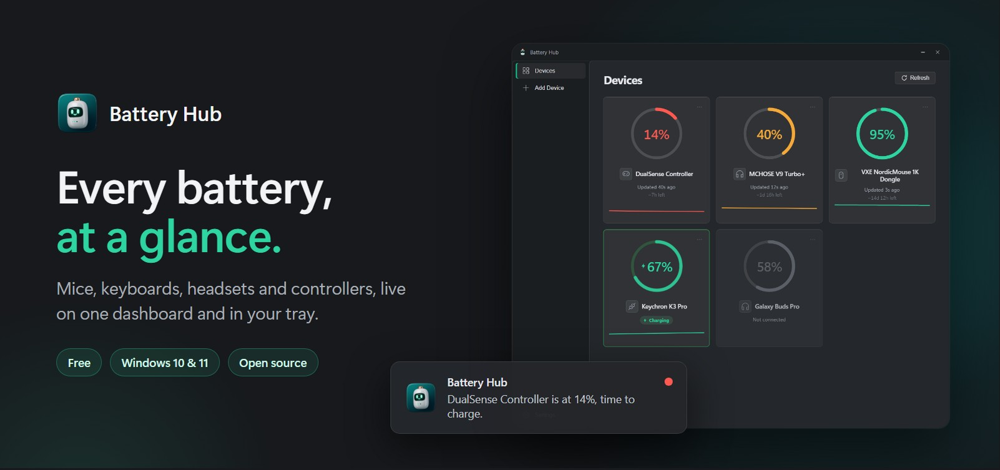

<div align="center">



<p>
  <a href="README.md"></a>
  <a href="README.es.md"></a>
  <a href="README.zh.md"></a>
  <a href="README.he.md"></a>
  <a href="README.pt.md"></a>
  <a href="README.ru.md"></a>
</p>

<p>
  <a href="https://github.com/battery-hub/battery-hub/releases/latest"></a>
  <a href="https://buymeacoffee.com/batteryhub"></a>
</p>

<p>
  <a href="https://github.com/battery-hub/battery-hub/releases/latest"></a>
  <a href="https://github.com/battery-hub/battery-hub/releases"></a>
  <a href="LICENSE"></a>
  
</p>

</div>

Battery Hub reads the battery level of your wireless devices straight from their receivers, cables and Bluetooth, shows them on one live dashboard and in the system tray, and warns you before anything runs flat. It's free, open source and runs entirely on your PC.

<p align="center">
  <a href="#features">Features</a> •
  <a href="#installation">Installation</a> •
  <a href="#getting-started">Getting started</a> •
  <a href="#supported-devices">Supported devices</a> •
  <a href="#troubleshooting">Troubleshooting</a> •
  <a href="#privacy">Privacy</a> •
  <a href="#building-from-source">Building from source</a>
</p>

## Features

- **Every device in one place**: mice, keyboards, headsets and controllers, each with a colour-coded charge ring.
- **Tray icons**: a live battery indicator for each device, next to the clock.
- **History and estimates**: 24-hour and 7-day charts, drain rate, time left and when it was last charged.
- **Low-battery alerts**: a Windows notification at the level you choose, for all devices or one at a time.
- **Knows when a device is off**: shows *Asleep or off* instead of an old reading.
- **Setup for unknown devices**: a 30-second scan finds the battery level of devices that aren't recognised automatically.
- **Six languages**: English, Español, 简体中文, עברית, Português and Русский.
- **Made for Windows 11**: light and dark themes, a tray flyout, a reduce-motion option and automatic updates.

## Installation

**Windows Package Manager**

```powershell
winget install DORON177.BatteryHub
```

**Installer**

Download `Battery-Hub-Installer-x.y.z.exe` from the [latest release](https://github.com/battery-hub/battery-hub/releases/latest) and run it. Battery Hub installs for the current user and needs no administrator rights.

> [!NOTE]
> The installer isn't code-signed, so Windows SmartScreen may show **"Windows protected your PC"**. Select **More info → Run anyway**. Signing certificates cost a yearly fee that this free project can't cover.

<details>
<summary><strong>Verifying a download</strong></summary>
<br>

Every release is built and published by [GitHub Actions](.github/workflows/release.yml) from a tagged commit, with no files uploaded by hand, and each one includes a `SHA256SUMS.txt`. In the folder you downloaded the installer to, run:

```powershell
Get-FileHash .\Battery-Hub-Installer-*.exe -Algorithm SHA256
```

and compare the hash with the one in that release's `SHA256SUMS.txt`. You can also search for the same hash on [VirusTotal](https://www.virustotal.com/gui/home/search) to see scan results for that exact file.

</details>

## Getting started

### Add a device

Open **Add device**. Devices Battery Hub recognises are marked **Supported**: just click **Add**. For any other device, click **Set up**:

1. Start the 30-second scan.
2. Turn the device off and on while it scans. Many wireless devices only report their battery when they power up.
3. Pick the value that matches your current battery level.
4. If the device uses a different scale, enter your real level and Battery Hub converts it from then on.

### The dashboard

Each card shows the level with a green, yellow or red ring, whether it's charging, a history sparkline, the time left and how old the reading is. Click a card for its full history. From the ⋯ menu you can rename a device, change its icon or hide it, and you can drag cards to reorder them. Hidden devices keep their setup, are no longer polled and can be restored at any time.

### Settings

Language, theme, card density, reduce motion, low-battery level, tray icons, launch at login and refresh interval.

## Supported devices

Battery Hub reads the devices below directly, plus any Bluetooth device that reports its battery to Windows. Most other wireless devices can be added with **Set up**.

<details>
<summary><strong>Show the full list</strong></summary>
<br>

| Family | Devices |
| --- | --- |
| Bluetooth | Any paired device that reports its battery to Windows |
| Xbox | Wireless controllers |
| PlayStation | DualSense, DualSense Edge, DualShock 4 (USB and Bluetooth) |
| Sony | INZONE Buds (USB dongle), INZONE H5, INZONE H9 II |
| Nintendo | Switch Pro Controller and clones, Joy-Con (Bluetooth) |
| Flydigi | Vader 4 Pro, Vader 5 Pro, Apex 4, 5 and 6 |
| 8BitDo | Ultimate 2 Wireless and Bluetooth, Ultimate 3 (D-input mode) |
| Valve | Steam Controller (2015, on its receiver) and Steam Controller (2026) |
| Other controllers | NVIDIA SHIELD controller, Amazon Luna (Bluetooth), SInput pads such as the ProGCC |
| Logitech | Mice and keyboards using HID++ 2.0 (Bolt, Unifying, Lightspeed, including the newest receiver of the PRO X3 SUPERSTRIKE); G PRO, G PRO X 2, G325, G533, G535, G633, G733, G933, G935 headsets |
| Razer | 90 wireless mice and keyboards (including the Basilisk V4 Pro and HyperSpeed, Naga V3 Pro, Orochi V2 and BlackWidow V4 Low Profile TKL); BlackShark V3, V3 Pro, V3 X HyperSpeed, V2 HyperSpeed, V2 Pro (2020), Kraken V4, Kraken V4 Pro (cable) and Nari headsets |
| SteelSeries | Arctis 1, 7, 7+, 9, Nova 3P, Nova 5, Nova 7, Nova Pro Wireless, Nova Pro Omni, Nova Elite headsets, Arctis GameBuds; Aerox, Aerox 3 Wireless Gen 2, Prime, Rival 3 Wireless, Rival 650 Wireless and Rival Pro mice; Apex Pro TKL Wireless and Apex Pro Mini Wireless keyboards |
| HyperX | Cloud Alpha Wireless, Cloud Alpha 2 Wireless, Cloud Core Wireless, Cloud Flight (also for PlayStation), Cloud Flight S, Cloud II Wireless, Cloud II Core Wireless, Cloud III Wireless, Cloud III S Wireless, Cloud Stinger 2 Wireless headsets; Pulsefire Haste 2 Wireless, Haste 2 Core and Dart mice |
| Corsair | Void, Void Wireless v2 (also on its cable), HS80 MAX, HS80 RGB, Virtuoso, Virtuoso SE, XT and MAX headsets; SABRE v3 PRO; Slipstream receivers and the Dark Core RGB Pro, Ironclaw, Harpoon and Katar Pro dongles; M65, M75, Dark Core, Scimitar, Nightsabre, NIGHTSWORD v2, Sabre and other wireless mice on their cable; K65 PLUS (and its dongle), K70 CORE TKL, K100 AIR, K70 PRO MINI and MAKR 75 keyboards on their cable |
| Audeze | Maxwell, Maxwell 2 (including the Xbox and ANC dongles) |
| Skullcandy | PLYR, Crusher PLYR 720 |
| ELECOM | BlueLED Mouse over Bluetooth (056e:00e5, listed as "Broadcom Bluetooth Wireless Mouse") |
| Astro | A50 Gen 4, A50 Gen 5 |
| Jabra | Link 380 and Link 390 dongles, Evolve3 75, Evolve2 65 Flex |
| Poly (Plantronics) | Voyager headsets on the BT600 dongle |
| JBL | Quantum 810, Quantum 910 |
| Lenovo | Wireless VoIP Headset |
| FIFINE | HT6 |
| MCHOSE | V9 Turbo+, V9 PRO, V9 Pro 2, X9 headsets; A7 V2 Ultra, A7 V2 Pro, A5 Ultra, K7 Ultra, A7 Ultra, G3 A mice; G75 V2, G87 V2, K87S, K99 V3, K87, G98 Pro keyboards; A5 V3, A7 V3, A7X Ultra, K7 V2, R7 Ultra, V7 Pro, G3 V3, G3 Ultra and A5 V2 Ultra mice |
| VXE, ATK, MADLIONS | Dragonfly R1 Pro, NordicMouse and other mice on Compx receivers; ATK NearLink and BitMouse receivers, X1 NearLink; ATK 8K Nano and 1K/8K dongles; Pulsar 8K Dongle Gen.2 and CrazyLight mice, Pulsar Xlite V4, X3 and Feinmann (Fusion2), G-Wolves 8K receiver, Endgame Gear XM2we, ATK A9 PRO MAX and Duckbill ELITE, ATK NearLink 8K dongle, A9 Ultimate and F1 NearLink, iRocks M31R, Zebronics receiver |
| Glorious, LAMZU | Model O, O-, D, D- Wireless; Maya X, Atlantis OG and Mini, TACHI, INCA, PARO, THORN and other LAMZU mice; WLmouse mice (Beast X Max and others), Attack Shark R5 Ultra |
| Beken/Xenta 2.4G receiver | Attack Shark and other mice on 1d57:fa60 and fa55 |
| ASUS | ROG Strix Go 2.4 and TUF Gaming H3 Wireless headsets; ROG Claymore II, Azoth, Azoth X, Azoth Extreme, Falchion, Falchion RX LP, Strix Scope II 96 and Scope RX TKL Wireless keyboards; ROG Gladius III, Gladius III AimPoint (and EVA-02), Chakram X, Harpe Ace, Harpe II Ace, Keris AimPoint, Keris II, Spatha X, TUF Gaming M4 and Mini, ProArt MD301, MD200 and mice on the ROG OMNI receiver |
| MSI | VERSA 300 Elite Wireless, VERSA PRO Wireless |
| Bloody | R73 Pro and other Bloody wireless mice |
| Waizowl | OGM 8K |
| NZXT | Lift Elite Wireless |
| Cooler Master | MM712, MM731 |
| VAXEE | Wireless mice on their dongles |
| Ninjutso | Sora V3 |
| CROCIRIS | X7 |
| DARKRIM | SHADOW |
| Delux | M800 Pro |
| Redragon | M690 PRO (receiver); M901P-KS, M913 and other mice on Compx receivers |
| Darmoshark | M3, N5 and other Darmoshark mice and receivers |
| AULA, EWEADN | Keyboards on their SONiX 2.4G receiver; AULA F108 Pro dongle |
| Lofree | Flow Lite84 |
| GANSS | GS3075T (2.4G) |
| Alienware | Pro Wireless Gaming Keyboard |
| Red Square | Alumix TKL |
| CHERRY | MX 3.0S Wireless |
| 1EA7 2.4G receiver | Generic 2.4G mice on 1ea7:0064 and 0066 |
| Rapoo | VT7 and VT9 Pro / VT3 MAX mice (24ae:1413, 1417), VT9 Pro V2, VT7 on its cable |
| YICHIP 2.4G receiver | AJAZZ AJ159 APEX, AJ179 PRO, Lingbao M5 Pro, Attack Shark R2 and other mice and keyboards on YICHIP and Rongyuan receivers (also MonsGeek, Epomaker, MSI, Trust and VGN ones) |
| BY Tech | PIAO 8K, EWEADN S9 and other BY Tech mice |
| Akko, Telink, Wobkey | Mice on the Akko 8K receiver, and Telink mice and Wobkey keyboards on the same platform |
| VGN | Dragonfly 3 MasterGT, Dragonfly Y2 / F1 V2, F1 V2 Extreme, Falcon3 Extreme and other VGN mice; N75 V2, V108, V87 V2, V98pro V3 keyboard dongles |
| Keychron, SKN | Mice on the Ultra-Link 8K receiver |
| YJX-chip 2.4G receiver | AJAZZ, XCTECH and other mice on YJX receivers (the same platform as MCHOSE G-series mice) |
| Compx 2.4G receiver | AULA F87 Pro and F99 Pro, Lingbao K98, MCHOSE G75 keyboards |

</details>

Tested on real hardware: VXE NordicMouse, MCHOSE V9 Turbo+, DualSense on USB and Bluetooth, Logitech MX Master 4 over Bluetooth, INZONE Buds on their USB dongle and the ELECOM BlueLED Mouse over Bluetooth. The rest are built from the protocols documented by the projects under [Acknowledgements](#acknowledgements) and checked against those byte layouts, so please [report a device](https://github.com/battery-hub/battery-hub/issues/new?template=device-support.yml) if one misbehaves.

A device connected two ways, such as a controller on its cable and over Bluetooth, shows as one card when both connections report the same Bluetooth address. Reading a PlayStation controller over Bluetooth switches it to its full report mode until it's turned off, as Steam and DS4Windows do; a few older games may not see the controller in that mode until it's turned off and on.

## Troubleshooting

- **Something isn't working.** Open **Settings → Help** and press **Run check**. It tests your install, your PC and your devices, tells you where the problem is, and can open a filled-in support request.
- **A device isn't recognised.** After two scans that find nothing, or three failed reads in a row, a **Send device report** button appears. It opens a filled-in device request on GitHub for you to check and submit.
- **Nothing is captured during a scan.** Run it again and turn the device off and on while it runs.
- **"Can't read this device's battery."** Some devices block battery requests in their driver and can't be read.
- **MCHOSE V9 Turbo+ says "needs Python + hid module".** This headset is read through Python. Install [Python](https://www.python.org/downloads/), then run `pip install hidapi`.
- **Logs** are written to `%APPDATA%\battery-hub\battery-hub.log`.

## Privacy

Battery Hub runs entirely on your PC and collects nothing. It goes online only to reach GitHub: to check for and download updates, and for the version check in **Settings → Help**. Device reports and support requests open a filled-in GitHub form in your browser, and nothing is sent until you submit it yourself. Battery history and settings stay in `%APPDATA%\battery-hub`.

## Building from source

Requires [Node.js](https://nodejs.org).

```bash
npm install
npm start          # run in development
npm test           # run the tests
npm run dist       # build the Windows installer into dist/
npm run installer  # wrap it in the branded installer window
```

| Path | Purpose |
| --- | --- |
| `src/main` | Electron main process: device polling, tray, notifications and updates |
| `src/main/hid/drivers` | Battery drivers for each device family; `table.js` lists the simple request-and-reply devices |
| `src/renderer` | The interface and its translations |
| `scripts` | Build tooling, icons and the screenshot (`npx electron scripts/screenshot.js`) |

`node-hid` runs in a separate utility process, so a driver fault can't take the app down.

## Contributing

Device requests, translations and pull requests are welcome. See [CONTRIBUTING.md](CONTRIBUTING.md) to get started, [CHANGELOG.md](CHANGELOG.md) for the release history and [SECURITY.md](SECURITY.md) to report a security issue.

## Acknowledgements

The device protocols build on the work of these open-source projects, and each driver names its sources: [HeadsetControl](https://github.com/Sapd/HeadsetControl), [OpenRazer](https://github.com/openrazer/openrazer), [rivalcfg](https://github.com/flozz/rivalcfg), [openinzone](https://github.com/penguinwokrs/openinzone), [SDL](https://github.com/libsdl-org/SDL), [OpenLinkHub](https://github.com/jurkovic-nikola/OpenLinkHub), [HaloBattery](https://github.com/HeyOkay/HaloBattery), the Linux kernel's HID drivers.

## Support the project

Battery Hub is free and will stay free. If it saved you from a dead mouse mid-game, you can [buy it a coffee](https://buymeacoffee.com/batteryhub). It helps keep the project going and add support for more devices.

## License

[MIT](LICENSE) © 2026 Battery Hub contributors
