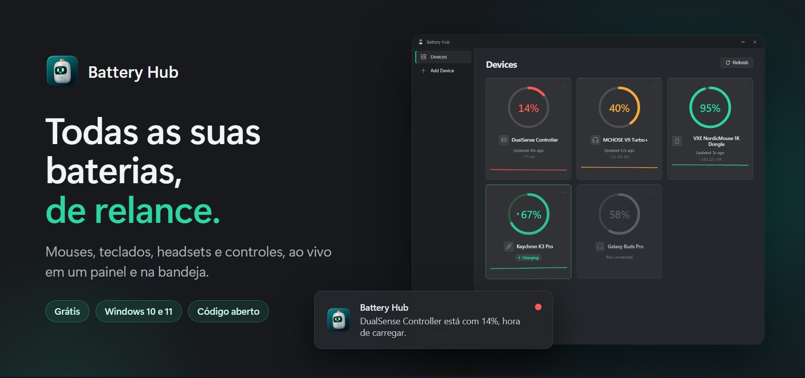

<div align="center">



<p>
  <a href="README.md"></a>
  <a href="README.es.md"></a>
  <a href="README.zh.md"></a>
  <a href="README.he.md"></a>
  <a href="README.pt.md"></a>
  <a href="README.ru.md"></a>
</p>

<p>
  <a href="https://github.com/battery-hub/battery-hub/releases/latest"></a>
  <a href="https://buymeacoffee.com/batteryhub"></a>
</p>

<p>
  <a href="https://github.com/battery-hub/battery-hub/releases/latest"></a>
  <a href="https://github.com/battery-hub/battery-hub/releases"></a>
  <a href="LICENSE"></a>
  
</p>

</div>

O Battery Hub lê o nível de bateria dos seus dispositivos sem fio direto dos receptores, cabos e Bluetooth, mostra tudo em um painel ao vivo e na bandeja do sistema, e avisa antes que algum fique sem carga. É gratuito, de código aberto e roda inteiramente no seu PC.

<p align="center">
  <a href="#recursos">Recursos</a> •
  <a href="#instalação">Instalação</a> •
  <a href="#primeiros-passos">Primeiros passos</a> •
  <a href="#dispositivos-compatíveis">Dispositivos compatíveis</a> •
  <a href="#solução-de-problemas">Solução de problemas</a> •
  <a href="#privacidade">Privacidade</a> •
  <a href="#compilar-a-partir-do-código-fonte">Compilar a partir do código-fonte</a>
</p>

## Recursos

- **Todos os dispositivos em um só lugar**: mouses, teclados, headsets e controles, cada um com um anel de carga colorido.
- **Ícones na bandeja**: um indicador de bateria ao vivo para cada dispositivo, ao lado do relógio.
- **Histórico e estimativas**: gráficos de 24 horas e 7 dias, ritmo de descarga, tempo restante e a última recarga.
- **Alertas de bateria fraca**: uma notificação do Windows no nível que você escolher, para todos os dispositivos ou para cada um.
- **Sabe quando um dispositivo está desligado**: mostra *Em repouso ou desligado* em vez de uma leitura antiga.
- **Configuração de dispositivos desconhecidos**: uma busca de 30 segundos encontra o nível de bateria dos dispositivos que não são reconhecidos automaticamente.
- **Seis idiomas**: English, Español, 简体中文, עברית, Português e Русский.
- **Feito para o Windows 11**: temas claro e escuro, painel na bandeja, opção de reduzir animações e atualizações automáticas.

## Instalação

**Gerenciador de Pacotes do Windows**

```powershell
winget install DORON177.BatteryHub
```

**Instalador**

Baixe `Battery-Hub-Installer-x.y.z.exe` da [versão mais recente](https://github.com/battery-hub/battery-hub/releases/latest) e execute. O Battery Hub é instalado para o usuário atual e não precisa de permissões de administrador.

> [!NOTE]
> O instalador não tem assinatura digital, então o Windows SmartScreen pode mostrar **"O Windows protegeu o computador"**. Selecione **Mais informações → Executar assim mesmo**. Certificados de assinatura têm um custo anual que este projeto gratuito não consegue pagar.

<details>
<summary><strong>Verificar um download</strong></summary>
<br>

Cada versão é compilada e publicada pelo [GitHub Actions](.github/workflows/release.yml) a partir de um commit com tag, sem arquivos enviados manualmente, e cada uma inclui um `SHA256SUMS.txt`. Na pasta para onde você baixou o instalador, execute:

```powershell
Get-FileHash .\Battery-Hub-Installer-*.exe -Algorithm SHA256
```

e compare o hash com o do `SHA256SUMS.txt` dessa versão. Você também pode pesquisar o mesmo hash no [VirusTotal](https://www.virustotal.com/gui/home/search) para ver os resultados de verificação desse arquivo exato.

</details>

## Primeiros passos

### Adicionar um dispositivo

Abra **Adicionar dispositivo**. Os dispositivos que o Battery Hub reconhece aparecem como **Compatível**: basta clicar em **Adicionar**. Para qualquer outro, clique em **Configurar**:

1. Inicie a busca de 30 segundos.
2. Desligue e ligue o dispositivo durante a busca. Muitos dispositivos sem fio só informam a bateria ao ligar.
3. Escolha o valor que corresponde ao nível de bateria atual.
4. Se o dispositivo usar outra escala, digite o nível real e o Battery Hub fará a conversão a partir daí.

### O painel

Cada cartão mostra o nível com um anel verde, amarelo ou vermelho, se está carregando, um gráfico de histórico, o tempo restante e a idade da leitura. Clique em um cartão para ver o histórico completo. No menu ⋯ você pode renomear um dispositivo, trocar o ícone ou ocultá-lo, e pode arrastar os cartões para reorganizá-los. Dispositivos ocultos mantêm a configuração, deixam de ser consultados e podem ser restaurados a qualquer momento.

### Configurações

Idioma, tema, densidade dos cartões, reduzir animações, nível de bateria fraca, ícones na bandeja, iniciar com o Windows e intervalo de atualização.

## Dispositivos compatíveis

O Battery Hub lê diretamente centenas de dispositivos da Logitech, Razer, SteelSeries, HyperX, Corsair, ASUS, Sony, MCHOSE, VXE, ATK, VGN, Redragon e muitas outras marcas, além de controles de Xbox, PlayStation, Nintendo, 8BitDo e Flydigi e qualquer dispositivo Bluetooth que informe a bateria ao Windows. A maioria dos outros pode ser adicionada com **Configurar**.

Veja a [lista completa de dispositivos](README.md#supported-devices) (em inglês) ou a do [site](https://battery-hub.github.io/battery-hub/). Se um dispositivo não funcionar direito, [avise-nos](https://github.com/battery-hub/battery-hub/issues/new?template=device-support.yml).

## Solução de problemas

- **Algo não está funcionando.** Abra **Configurações → Ajuda** e clique em **Verificar**. Ele testa a instalação, o PC e os dispositivos, mostra onde está o problema e pode abrir um pedido de suporte já preenchido.
- **Um dispositivo não é reconhecido.** Depois de duas buscas sem resultado, ou três leituras com falha seguidas, aparece o botão **Enviar relatório do dispositivo**. Ele abre no GitHub um pedido já preenchido para você revisar e enviar.
- **A busca não captura nada.** Execute de novo e desligue e ligue o dispositivo durante a busca.
- **"Não é possível ler a bateria deste dispositivo."** Alguns dispositivos bloqueiam as consultas de bateria no driver e não podem ser lidos.
- **O MCHOSE V9 Turbo+ mostra "needs Python + hid module".** Este headset é lido via Python. Instale o [Python](https://www.python.org/downloads/) e depois execute `pip install hidapi`.
- **Os logs** são gravados em `%APPDATA%\battery-hub\battery-hub.log`.

## Privacidade

O Battery Hub roda inteiramente no seu PC e não coleta nada. Ele só se conecta ao GitHub: para procurar e baixar atualizações, e para a verificação de versão em **Configurações → Ajuda**. Relatórios de dispositivos e pedidos de suporte abrem no navegador um formulário do GitHub já preenchido, e nada é enviado até que você mesmo envie. O histórico de bateria e as configurações ficam em `%APPDATA%\battery-hub`.

## Compilar a partir do código-fonte

Requer [Node.js](https://nodejs.org).

```bash
npm install
npm start          # executar em modo de desenvolvimento
npm test           # executar os testes
npm run dist       # gerar o instalador do Windows em dist/
npm run installer  # empacotá-lo na janela do instalador
```

| Caminho | Função |
| --- | --- |
| `src/main` | Processo principal do Electron: leitura dos dispositivos, bandeja, notificações e atualizações |
| `src/main/hid/drivers` | Drivers de bateria de cada família de dispositivos; `table.js` reúne os dispositivos de pergunta e resposta simples |
| `src/renderer` | A interface e suas traduções |
| `scripts` | Ferramentas de build, ícones e a captura de tela (`npx electron scripts/screenshot.js`) |

O `node-hid` roda em um processo separado, então uma falha de driver não derruba o aplicativo.

## Como contribuir

Pedidos de dispositivos, traduções e pull requests são bem-vindos. Veja [CONTRIBUTING.md](CONTRIBUTING.md) para começar, [CHANGELOG.md](CHANGELOG.md) para o histórico de versões e [SECURITY.md](SECURITY.md) para relatar um problema de segurança.

## Agradecimentos

Os protocolos dos dispositivos se baseiam no trabalho destes projetos de código aberto, e cada driver cita suas fontes: [HeadsetControl](https://github.com/Sapd/HeadsetControl), [OpenRazer](https://github.com/openrazer/openrazer), [rivalcfg](https://github.com/flozz/rivalcfg), [openinzone](https://github.com/penguinwokrs/openinzone), [SDL](https://github.com/libsdl-org/SDL), [OpenLinkHub](https://github.com/jurkovic-nikola/OpenLinkHub), [HaloBattery](https://github.com/HeyOkay/HaloBattery), os drivers HID do kernel Linux.

## Apoie o projeto

O Battery Hub é gratuito e vai continuar sendo. Se ele te salvou de um mouse descarregado no meio da partida, você pode [pagar um café](https://buymeacoffee.com/batteryhub). Isso ajuda a manter o projeto e a adicionar mais dispositivos.

## Licença

[MIT](LICENSE) © 2026 Battery Hub contributors
