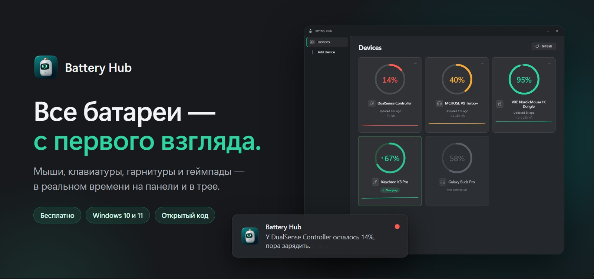

<div align="center">



<p>
  <a href="README.md"></a>
  <a href="README.es.md"></a>
  <a href="README.zh.md"></a>
  <a href="README.he.md"></a>
  <a href="README.pt.md"></a>
  <a href="README.ru.md"></a>
</p>

<p>
  <a href="https://github.com/battery-hub/battery-hub/releases/latest"></a>
  <a href="https://buymeacoffee.com/batteryhub"></a>
</p>

<p>
  <a href="https://github.com/battery-hub/battery-hub/releases/latest"></a>
  <a href="https://github.com/battery-hub/battery-hub/releases"></a>
  <a href="LICENSE"></a>
  
</p>

</div>

Battery Hub считывает уровень заряда беспроводных устройств напрямую через их приёмники, кабели и Bluetooth, показывает его на единой панели и в области уведомлений и предупреждает, пока что-нибудь не разрядилось. Приложение бесплатное, с открытым исходным кодом и работает полностью на вашем компьютере.

<p align="center">
  <a href="#возможности">Возможности</a> •
  <a href="#установка">Установка</a> •
  <a href="#начало-работы">Начало работы</a> •
  <a href="#поддерживаемые-устройства">Поддерживаемые устройства</a> •
  <a href="#устранение-неполадок">Устранение неполадок</a> •
  <a href="#конфиденциальность">Конфиденциальность</a> •
  <a href="#сборка-из-исходного-кода">Сборка из исходного кода</a>
</p>

## Возможности

- **Все устройства в одном месте**: мыши, клавиатуры, гарнитуры и геймпады, у каждого цветной индикатор заряда.
- **Значки в области уведомлений**: живой индикатор заряда для каждого устройства рядом с часами.
- **История и прогнозы**: графики за 24 часа и 7 дней, скорость разряда, оставшееся время и время последней зарядки.
- **Уведомления о низком заряде**: уведомление Windows на выбранном вами уровне, для всех устройств сразу или для каждого отдельно.
- **Понимает, когда устройство выключено**: показывает *Спит или выключено* вместо устаревших данных.
- **Настройка неизвестных устройств**: 30-секундное сканирование находит уровень заряда устройств, которые не распознаются автоматически.
- **Шесть языков**: English, Español, 简体中文, עברית, Português и Русский.
- **Создано для Windows 11**: светлая и тёмная темы, всплывающее окно в трее, уменьшение анимации и автоматические обновления.

## Установка

**Диспетчер пакетов Windows**

```powershell
winget install DORON177.BatteryHub
```

**Установщик**

Скачайте `Battery-Hub-Installer-x.y.z.exe` из [последнего релиза](https://github.com/battery-hub/battery-hub/releases/latest) и запустите его. Battery Hub устанавливается для текущего пользователя и не требует прав администратора.

> [!NOTE]
> Установщик не подписан цифровой подписью, поэтому Windows SmartScreen может показать **«Система Windows защитила ваш компьютер»**. Выберите **Подробнее → Выполнить в любом случае**. Сертификаты подписи стоят ежегодной платы, которую этот бесплатный проект не может себе позволить.

<details>
<summary><strong>Проверка загруженного файла</strong></summary>
<br>

Каждый релиз собирается и публикуется через [GitHub Actions](.github/workflows/release.yml) из коммита с тегом, без ручной загрузки файлов, и содержит `SHA256SUMS.txt`. В папке, куда вы скачали установщик, выполните:

```powershell
Get-FileHash .\Battery-Hub-Installer-*.exe -Algorithm SHA256
```

и сравните результат с хешем в `SHA256SUMS.txt` этого релиза. Тот же хеш можно найти на [VirusTotal](https://www.virustotal.com/gui/home/search), чтобы посмотреть результаты проверки именно этого файла.

</details>

## Начало работы

### Добавление устройства

Откройте **Добавить устройство**. Устройства, которые Battery Hub распознаёт, отмечены как **Поддерживается**: просто нажмите **Добавить**. Для любого другого устройства нажмите **Настроить**:

1. Запустите 30-секундное сканирование.
2. Выключите и включите устройство во время сканирования. Многие беспроводные устройства сообщают заряд только при включении.
3. Выберите значение, которое совпадает с текущим уровнем заряда.
4. Если устройство использует другую шкалу, введите реальный уровень, и дальше Battery Hub будет пересчитывать его сам.

### Панель

Каждая карточка показывает уровень заряда с зелёным, жёлтым или красным кольцом, идёт ли зарядка, график истории, оставшееся время и давность показаний. Нажмите на карточку, чтобы увидеть полную историю. В меню ⋯ можно переименовать устройство, сменить его значок или скрыть его, а карточки можно перетаскивать, чтобы изменить порядок. Скрытые устройства сохраняют настройку, больше не опрашиваются и могут быть восстановлены в любой момент.

### Настройки

Язык, тема, плотность карточек, уменьшение анимации, уровень низкого заряда, значки в трее, запуск при входе в систему и интервал обновления.

## Поддерживаемые устройства

Battery Hub напрямую считывает сотни устройств Logitech, Razer, SteelSeries, HyperX, Corsair, ASUS, Sony, MCHOSE, VXE, ATK, VGN, Redragon и многих других брендов, а также геймпады Xbox, PlayStation, Nintendo, 8BitDo и Flydigi и любые Bluetooth-устройства, которые сообщают заряд Windows. Большинство остальных устройств можно добавить через **Настроить**.

Смотрите [полный список устройств](README.md#supported-devices) (на английском) или список [на сайте](https://battery-hub.github.io/battery-hub/). Если устройство работает неправильно, [сообщите нам](https://github.com/battery-hub/battery-hub/issues/new?template=device-support.yml).

## Устранение неполадок

- **Что-то не работает.** Откройте **Настройки → Помощь** и нажмите **Запустить проверку**. Она проверит установку, компьютер и устройства, покажет, в чём проблема, и может открыть заполненный запрос в поддержку.
- **Устройство не распознаётся.** После двух сканирований без результата или трёх неудачных чтений подряд появляется кнопка **Отправить отчёт об устройстве**. Она открывает на GitHub заполненный запрос, который вы можете проверить и отправить.
- **Сканирование ничего не находит.** Запустите его снова и выключите и включите устройство во время сканирования.
- **«Не удаётся прочитать заряд этого устройства».** Некоторые устройства блокируют запросы заряда на уровне драйвера, и прочитать их нельзя.
- **MCHOSE V9 Turbo+ показывает «needs Python + hid module».** Заряд этой гарнитуры считывается через Python. Установите [Python](https://www.python.org/downloads/), затем выполните `pip install hidapi`.
- **Журналы** сохраняются в `%APPDATA%\battery-hub\battery-hub.log`.

## Конфиденциальность

Battery Hub работает полностью на вашем компьютере и ничего не собирает. В интернет он выходит только к GitHub: чтобы проверить и скачать обновления и для проверки версии в **Настройки → Помощь**. Отчёты об устройствах и запросы в поддержку открывают в браузере заполненную форму GitHub, и ничего не отправляется, пока вы сами её не отправите. История заряда и настройки хранятся в `%APPDATA%\battery-hub`.

## Сборка из исходного кода

Требуется [Node.js](https://nodejs.org).

```bash
npm install
npm start          # запуск в режиме разработки
npm test           # запуск тестов
npm run dist       # сборка установщика Windows в dist/
npm run installer  # упаковка в фирменное окно установщика
```

| Путь | Назначение |
| --- | --- |
| `src/main` | Главный процесс Electron: опрос устройств, трей, уведомления и обновления |
| `src/main/hid/drivers` | Драйверы заряда для каждого семейства устройств; `table.js` содержит устройства с простым запросом и ответом |
| `src/renderer` | Интерфейс и его переводы |
| `scripts` | Инструменты сборки, значки и снимок экрана (`npx electron scripts/screenshot.js`) |

`node-hid` работает в отдельном процессе, поэтому сбой драйвера не может уронить приложение.

## Участие в разработке

Запросы на поддержку устройств, переводы и pull request-ы приветствуются. Смотрите [CONTRIBUTING.md](CONTRIBUTING.md), чтобы начать, [CHANGELOG.md](CHANGELOG.md) с историей релизов и [SECURITY.md](SECURITY.md), чтобы сообщить о проблеме безопасности.

## Благодарности

Протоколы устройств основаны на работе этих проектов с открытым исходным кодом, и каждый драйвер указывает свои источники: [HeadsetControl](https://github.com/Sapd/HeadsetControl), [OpenRazer](https://github.com/openrazer/openrazer), [rivalcfg](https://github.com/flozz/rivalcfg), [openinzone](https://github.com/penguinwokrs/openinzone), [SDL](https://github.com/libsdl-org/SDL), [OpenLinkHub](https://github.com/jurkovic-nikola/OpenLinkHub), [HaloBattery](https://github.com/HeyOkay/HaloBattery), HID-драйверы ядра Linux.

## Поддержать проект

Battery Hub бесплатен и останется бесплатным. Если он спас вас от разряженной мыши посреди игры, можно [угостить его кофе](https://buymeacoffee.com/batteryhub). Это помогает развивать проект и добавлять поддержку новых устройств.

## Лицензия

[MIT](LICENSE) © 2026 Battery Hub contributors
