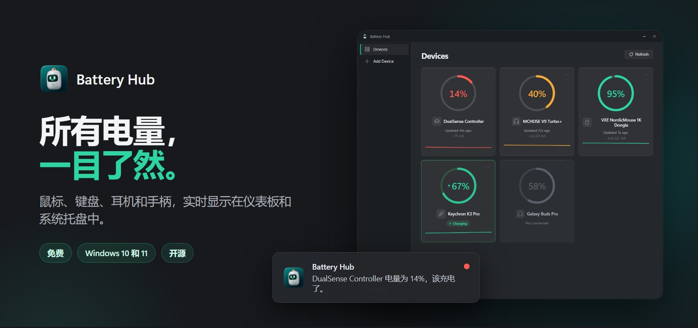

<div align="center">



<p>
  <a href="README.md"></a>
  <a href="README.es.md"></a>
  <a href="README.zh.md"></a>
  <a href="README.he.md"></a>
  <a href="README.pt.md"></a>
  <a href="README.ru.md"></a>
</p>

<p>
  <a href="https://github.com/battery-hub/battery-hub/releases/latest"></a>
  <a href="https://buymeacoffee.com/batteryhub"></a>
</p>

<p>
  <a href="https://github.com/battery-hub/battery-hub/releases/latest"></a>
  <a href="https://github.com/battery-hub/battery-hub/releases"></a>
  <a href="LICENSE"></a>
  
</p>

</div>

Battery Hub 直接从接收器、数据线和蓝牙读取无线设备的电量，在实时仪表板和系统托盘中显示，并在设备电量耗尽前提醒你。它免费、开源，并且完全在你的电脑上运行。

<p align="center">
  <a href="#功能">功能</a> •
  <a href="#安装">安装</a> •
  <a href="#快速上手">快速上手</a> •
  <a href="#支持的设备">支持的设备</a> •
  <a href="#故障排除">故障排除</a> •
  <a href="#隐私">隐私</a> •
  <a href="#从源代码构建">从源代码构建</a>
</p>

## 功能

- **所有设备一目了然**: 鼠标、键盘、耳机和手柄，每个都有按颜色区分的电量环。
- **托盘图标**: 每个设备都有一个实时电量图标，显示在时钟旁边。
- **历史与估计**: 24 小时和 7 天图表、耗电速度、剩余时间以及上次充电时间。
- **低电量提醒**: 在你设定的电量时弹出 Windows 通知，可统一设置或为每个设备单独设置。
- **识别设备已关闭**: 显示*休眠或已关闭*，而不是旧的读数。
- **未知设备设置**: 30 秒扫描即可找到无法自动识别的设备的电量。
- **六种语言**: English、Español、简体中文、עברית、Português 和 Русский。
- **为 Windows 11 打造**: 浅色和深色主题、托盘弹出窗口、减少动画选项以及自动更新。

## 安装

**Windows 程序包管理器**

```powershell
winget install DORON177.BatteryHub
```

**安装程序**

从[最新版本](https://github.com/battery-hub/battery-hub/releases/latest)下载 `Battery-Hub-Installer-x.y.z.exe` 并运行。Battery Hub 为当前用户安装，无需管理员权限。

> [!NOTE]
> 安装程序没有代码签名，因此 Windows SmartScreen 可能会显示 **"Windows 已保护你的电脑"**。请选择 **更多信息 → 仍要运行**。签名证书需要每年付费，而这个免费项目无力承担。

<details>
<summary><strong>验证下载</strong></summary>
<br>

每个版本都由 [GitHub Actions](.github/workflows/release.yml) 从带标签的提交自动构建和发布，不会手动上传任何文件，并附带 `SHA256SUMS.txt`。在下载安装程序的文件夹中运行：

```powershell
Get-FileHash .\Battery-Hub-Installer-*.exe -Algorithm SHA256
```

然后将结果与该版本 `SHA256SUMS.txt` 中的哈希值进行比较。你也可以在 [VirusTotal](https://www.virustotal.com/gui/home/search) 上搜索同一个哈希值，查看该文件的扫描结果。

</details>

## 快速上手

### 添加设备

打开 **添加设备**。Battery Hub 能识别的设备会标记为 **已支持**：直接点击 **添加** 即可。其他设备请点击 **设置**：

1. 开始 30 秒扫描。
2. 扫描期间将设备关闭再打开。许多无线设备只在开机时报告电量。
3. 选择与当前电量相符的数值。
4. 如果设备使用不同的刻度，输入实际电量，Battery Hub 之后会自动换算。

### 仪表板

每张卡片显示电量和绿色、黄色或红色的电量环、是否正在充电、历史曲线、剩余时间以及读数的新旧。点击卡片可查看完整历史。在 ⋯ 菜单中可以重命名设备、更换图标或隐藏设备，也可以拖动卡片调整顺序。隐藏的设备会保留设置、停止轮询，并可随时恢复。

### 设置

语言、主题、卡片密度、减少动画、低电量阈值、托盘图标、开机启动和刷新间隔。

## 支持的设备

Battery Hub 可直接读取罗技、雷蛇、赛睿、HyperX、海盗船、华硕、索尼、迈从 (MCHOSE)、VXE、ATK、VGN、红龙 (Redragon) 等众多品牌的数百款设备，以及 Xbox、PlayStation、任天堂、8BitDo 和飞智手柄，还有任何向 Windows 报告电量的蓝牙设备。大多数其他设备可以通过 **设置** 添加。

查看[完整设备列表](README.md#supported-devices)（英文）或[网站](https://battery-hub.github.io/battery-hub/)上的列表。如果某个设备工作不正常，请[告诉我们](https://github.com/battery-hub/battery-hub/issues/new?template=device-support.yml)。

## 故障排除

- **出现问题。** 打开 **设置 → 帮助** 并点击 **开始检查**。它会检查安装、电脑和设备，告诉你问题所在，并可打开一份已填好的支持请求。
- **设备无法识别。** 两次扫描都没有结果，或连续三次读取失败后，会出现 **发送设备报告** 按钮。它会在 GitHub 上打开一份已填好的设备请求，供你检查后提交。
- **扫描没有捕获到任何内容。** 重新扫描，并在扫描时将设备关闭再打开。
- **"无法读取此设备的电量。"** 有些设备在驱动层面阻止电量查询，无法读取。
- **MCHOSE V9 Turbo+ 显示 "needs Python + hid module"。** 这款耳机通过 Python 读取。请安装 [Python](https://www.python.org/downloads/)，然后运行 `pip install hidapi`。
- **日志** 保存在 `%APPDATA%\battery-hub\battery-hub.log`。

## 隐私

Battery Hub 完全在你的电脑上运行，不收集任何数据。它只连接 GitHub：检查和下载更新，以及 **设置 → 帮助** 中的版本检查。设备报告和支持请求会在浏览器中打开一份已填好的 GitHub 表单，在你亲自提交之前不会发送任何内容。电量历史和设置保存在 `%APPDATA%\battery-hub`。

## 从源代码构建

需要 [Node.js](https://nodejs.org)。

```bash
npm install
npm start          # 以开发模式运行
npm test           # 运行测试
npm run dist       # 将 Windows 安装程序构建到 dist/
npm run installer  # 封装为带品牌界面的安装程序
```

| 路径 | 用途 |
| --- | --- |
| `src/main` | Electron 主进程：设备轮询、托盘、通知和更新 |
| `src/main/hid/drivers` | 各设备系列的电量驱动；`table.js` 列出简单的请求-应答设备 |
| `src/renderer` | 界面及其翻译 |
| `scripts` | 构建工具、图标和截图（`npx electron scripts/screenshot.js`） |

`node-hid` 在独立的工具进程中运行，驱动出错也不会导致应用崩溃。

## 参与贡献

欢迎提交设备请求、翻译和拉取请求。请参阅 [CONTRIBUTING.md](CONTRIBUTING.md) 了解如何开始，[CHANGELOG.md](CHANGELOG.md) 查看版本历史，[SECURITY.md](SECURITY.md) 报告安全问题。

## 致谢

设备协议建立在以下开源项目的成果之上，每个驱动都注明了其来源： [HeadsetControl](https://github.com/Sapd/HeadsetControl), [OpenRazer](https://github.com/openrazer/openrazer), [rivalcfg](https://github.com/flozz/rivalcfg), [openinzone](https://github.com/penguinwokrs/openinzone), [SDL](https://github.com/libsdl-org/SDL), [OpenLinkHub](https://github.com/jurkovic-nikola/OpenLinkHub), [HaloBattery](https://github.com/HeyOkay/HaloBattery), Linux 内核的 HID 驱动.

## 支持本项目

Battery Hub 是免费的，并将一直免费。如果它让你免于在游戏中途鼠标没电，可以[请它喝杯咖啡](https://buymeacoffee.com/batteryhub)。这有助于项目持续发展并支持更多设备。

## 许可证

[MIT](LICENSE) © 2026 Battery Hub contributors
